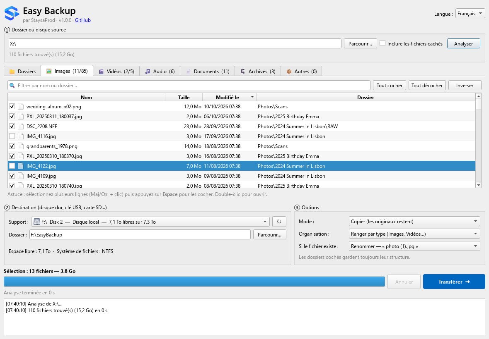

  

<h1 align="center">Easy Backup</h1>

  Sauvegardez vos photos, vidéos et documents sur un disque externe en quelques clics. 
  Application Windows gratuite et open source.

  <a href="https://github.com/gattoufirabi/easy-backup-app/releases/latest/download/EasyBackup-Setup.exe"><b>⬇ Télécharger pour Windows</b></a> ·
  <a href="https://gattoufirabi.github.io/easy-backup/">Site web</a> ·
  <a href="README.md">English</a>

  

## Fonctionnalités

- **Fichiers classés par type** — images, vidéos, audio, documents, archives et autres ont chacun leur onglet, avec taille, date et dossier. Filtre, tri, tout cocher ou inverser en un clic.
- **Dossiers entiers** — arborescence avec la taille et le nombre de fichiers de chaque dossier. Un dossier coché est transféré en entier (sous-dossiers, dossiers vides et fichiers cachés compris) ; déplacer un dossier sur le même disque est instantané.
- **Rapide** — un moteur d'analyse parallèle écrit en Go liste un disque entier en quelques secondes, sans jamais figer la fenêtre.
- **Transferts sûrs** — copie via un fichier temporaire (jamais de fichier à moitié écrit), taille vérifiée après chaque copie ; en déplacement, l'original n'est supprimé qu'une fois la copie terminée et écrite sur le disque.
- **Fait pour les disques externes** — disques amovibles en premier, vérification de l'espace libre, alerte pour les fichiers de plus de 4 Go en FAT32, arrêt propre si le disque est débranché ou plein.
- **À votre façon** — copier ou déplacer ; ranger par type, garder la structure d'origine ou tout mettre dans un dossier ; renommer, ignorer ou remplacer les fichiers existants.
- **Progression en direct** — fichiers trouvés, taille, vitesse et temps restant ; analyses et transferts annulables à tout moment.
- **Français et anglais** — langue choisie à l'installation, modifiable dans l'application.
- **Hors-ligne** — pas de compte, pas de cloud, aucune collecte de données. L'installeur contient tout et l'application ne se connecte jamais à Internet.

## Installation

Téléchargez [`EasyBackup-Setup.exe`](https://github.com/gattoufirabi/easy-backup-app/releases/latest/download/EasyBackup-Setup.exe) et lancez-le. Windows 10 ou 11, 64 bits. Pas besoin de droits administrateur.

> L'installeur n'est pas encore signé numériquement : Windows SmartScreen peut afficher *« Windows a protégé votre ordinateur »*. Cliquez sur **Informations complémentaires → Exécuter quand même**. Chaque version est construite à partir de ce dépôt par [GitHub Actions](.github/workflows/release.yml).

## Compiler depuis les sources

Voir la section *Build from source* du [README anglais](README.md#build-from-source) et le [guide de contribution](CONTRIBUTING.md).

## Licence

Easy Backup est un logiciel libre, distribué sous [licence GNU GPL v3](LICENSE).
Les composants tiers et leurs licences sont listés dans [THIRD_PARTY_NOTICES.md](THIRD_PARTY_NOTICES.md).
Le nom et le logo StaysaProd ne sont pas couverts par la GPL.
