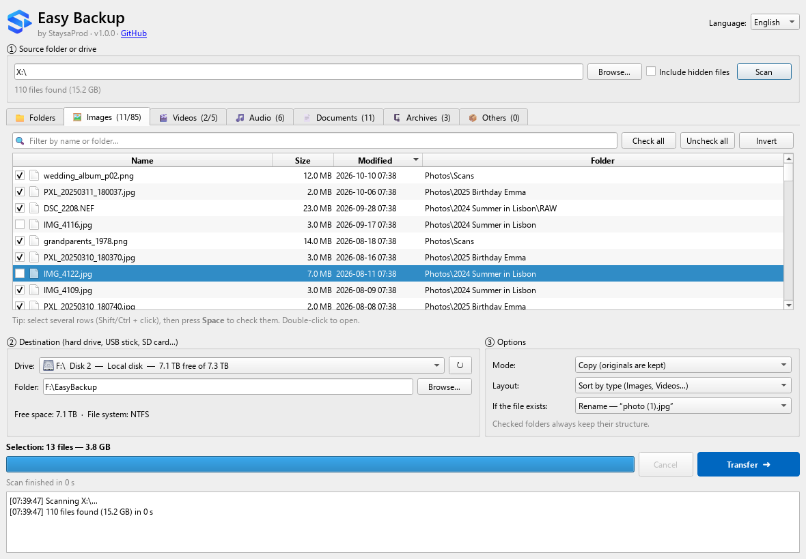

<p align="center">
  
</p>

<h1 align="center">Easy Backup</h1>

<p align="center">
  Back up your photos, videos and documents to an external drive in a few clicks.<br>
  Free and open-source Windows app.
</p>

<p align="center">
  <a href="https://github.com/gattoufirabi/easy-backup-app/releases/latest/download/EasyBackup-Setup.exe"><b>⬇ Download for Windows</b></a> ·
  <a href="https://gattoufirabi.github.io/easy-backup/">Website</a> ·
  <a href="README.fr.md">Français</a>
</p>

<p align="center">
  <a href="https://github.com/gattoufirabi/easy-backup-app/releases/latest"></a>
  <a href="https://github.com/gattoufirabi/easy-backup-app/actions/workflows/ci.yml"></a>
  <a href="LICENSE"></a>
</p>

<p align="center">
  
</p>

## Features

- **Files sorted by type** — images, videos, audio, documents, archives and others each get their own tab, with size, date and folder. Filter, sort, check all or invert in one click.
- **Whole folders** — a folder tree with the size and file count of each folder. A checked folder is transferred as a whole (subfolders, empty folders and hidden files included); moving a folder on the same drive is instant.
- **Fast** — a parallel scanning engine written in Go lists a whole drive in seconds (about 320,000 files in 3 s on a warm cache), and the window never freezes.
- **Safe transfers** — copies go through a temporary file (never a half-written file), sizes are checked after each copy, and when moving, the original is deleted only once the copy is complete and flushed to disk.
- **Made for external drives** — removable drives listed first, free space check, warning for files over 4 GB on FAT32, clean stop if the drive is unplugged or full.
- **Your layout** — copy or move; sort by type, keep the original structure or put everything in one folder; rename, skip or replace existing files.
- **Live progress** — files found, size, speed and time remaining; scans and transfers can be cancelled at any time.
- **English and French** — chosen in the installer, switchable from the app.
- **Offline** — no account, no cloud, no telemetry. The installer contains everything and the app never connects to the Internet.

## Install

Download [`EasyBackup-Setup.exe`](https://github.com/gattoufirabi/easy-backup-app/releases/latest/download/EasyBackup-Setup.exe) and run it. Windows 10 or 11, 64-bit. No administrator rights needed.

> The installer is not code-signed yet, so Windows SmartScreen may show *“Windows protected your PC”*. Click **More info → Run anyway**. Every release is built from this repository by [GitHub Actions](.github/workflows/release.yml).

## How it works

```
┌──────────────────────────┐   JSON lines (stdout)   ┌─────────────────────────────┐
│  Interface — Python / Qt │ ◀────────────────────── │  Engine — Go (ebengine.exe) │
│  easybackup/             │ ──────────────────────▶ │  engine/                    │
│  lists, selection, UI    │   job file + "cancel"   │  parallel scan, copy, move  │
└──────────────────────────┘        (stdin)          └─────────────────────────────┘
```

The engine runs as a hidden background process. It can also be used on its own:

```bash
bin\ebengine.exe scan --root "D:\Photos" --lang en
```

| Path | Role |
|---|---|
| `main.py` | entry point |
| `easybackup/window.py` | main window |
| `easybackup/models.py` | file list and folder tree models (sorting, filtering, selection) |
| `easybackup/scanner.py`, `transfer.py`, `engine.py` | bridge between the window and the engine |
| `easybackup/i18n.py` | translations (French source texts → English) |
| `engine/scan.go` | parallel scan |
| `engine/transfer.go`, `dirs.go` | copy / move of files and whole folders, conflicts, errors |
| `engine/categories.go` | file extension → type |
| `installer/EasyBackup.iss` | Inno Setup installer |
| `tests/` | tests (pytest) |

## Build from source

Requirements: Windows, [Python 3.11+](https://www.python.org/), [Go 1.22+](https://go.dev/dl/), and [Inno Setup 6](https://jrsoftware.org/isinfo.php) for the installer.

```bash
python -m venv .venv
.venv\Scripts\pip install -r requirements-dev.txt
build_engine.bat
.venv\Scripts\python main.py
```

Run the tests:

```bash
.venv\Scripts\python -m pytest
```

Build the offline installer (`dist\EasyBackup-Setup-<version>.exe`):

```bash
build_installer.bat 1.0.0
```

## Contributing

Bug reports, ideas, translations and pull requests are welcome — see [CONTRIBUTING.md](CONTRIBUTING.md).

## License

Easy Backup is free software, released under the [GNU General Public License v3.0](LICENSE).
Third-party components and their licenses are listed in [THIRD_PARTY_NOTICES.md](THIRD_PARTY_NOTICES.md).
The StaysaProd name and logo are not covered by the GPL.
